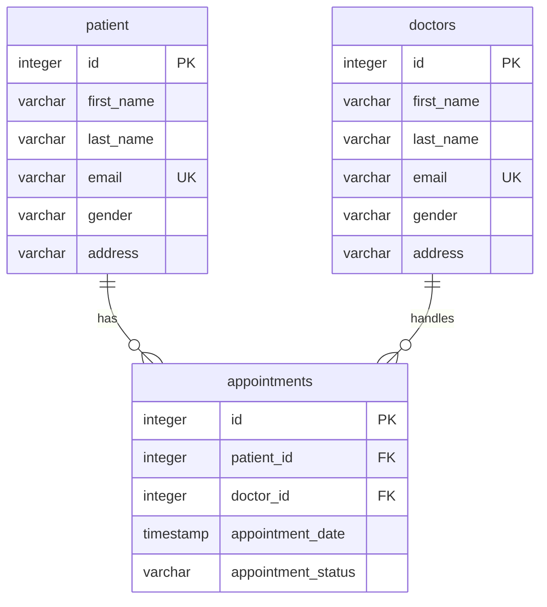

# Hospital Management Database

## Project overview

This project is a relational database exercise built with PostgreSQL. It models three core areas of a hospital workflow: patients, doctors, and appointments. The project is part of my ongoing PostgreSQL and Database Administration (DBA) learning portfolio.

## Objectives

- Design and inspect a relational database schema.
- Apply primary-key, unique, and foreign-key constraints.
- Connect related tables using SQL `JOIN` operations.
- Practise filtering, grouping, aggregation, and reporting queries.
- Explore appointment analysis by year and calendar quarter.

## Technology

- PostgreSQL 18.6
- SQL
- pgAdmin 4 / PostgreSQL command-line tools

## Database structure

| Table | Purpose | Important columns |
|---|---|---|
| `patient` | Stores patient details | `id`, `first_name`, `last_name`, `email`, `gender`, `address` |
| `doctors` | Stores doctor details | `id`, `first_name`, `last_name`, `email`, `gender`, `address` |
| `appointments` | Records appointments and links patients to doctors | `id`, `patient_id`, `doctor_id`, `appointment_date`, `appointment_status` |

### Relationships

- One patient can have multiple appointments.
- One doctor can have multiple appointments.
- Each appointment references one patient and one doctor.

## Constraints implemented

- Primary keys uniquely identify rows in all three tables.
- Patient email addresses have a `UNIQUE` constraint.
- Doctor email addresses have a `UNIQUE` constraint.
- Appointment `patient_id` references `patient.id`.
- Appointment `doctor_id` references `doctors.id`.
- Required columns are defined as `NOT NULL` in the schema.

## Files in this project

- `schema.sql` — portable table and constraint creation script based on the database schema export.
- `schema_pg_dump.sql` — original schema-only export produced by `pg_dump` 18.6.
- `queries.sql` — example queries for joins, patient/doctor appointment history, status summaries, `LEFT JOIN`, and quarterly reporting.

## How to run

1. Create or select an empty PostgreSQL database for this project.
2. Open `schema.sql` in pgAdmin Query Tool (connected to that database), or run it with `psql`.
3. Execute the statements in `queries.sql` after adding suitable test records.

The project currently contains the schema and practice queries. A data-loading script is not included yet; add only fictional or otherwise safely anonymised test records before publishing sample data.

## DBA review notes and possible improvements

The exported schema shows that `patient.id` is generated by an identity column, while `doctors.id` and `appointments.id` are integer primary keys without identity generation. New doctor and appointment records therefore require IDs to be supplied unless the schema is deliberately enhanced.

Other possible enhancements to evaluate in a future iteration:

- Decide whether patient and doctor email addresses should be mandatory; they are currently nullable even though non-null values must be unique.
- Add controlled values or `CHECK` constraints for fields such as `gender` and `appointment_status`, after defining the accepted values.
- Review indexes for common appointment searches, such as by patient, doctor, and appointment date.
- Define appropriate update/delete behaviour for the foreign keys based on the intended record-retention rules.
- Add backup and restore documentation and test it on a separate database.

These are improvement ideas, not features currently implemented in the exported schema.

## Learning outcomes

Through this project I am practising relational schema inspection, primary and foreign keys, uniqueness constraints, multi-table joins, `LEFT JOIN`, aggregation with `GROUP BY`, and date-part analysis using `EXTRACT`.

## Data protection

No patient records or live personal data are included in this repository. Any future sample data should be fictional or safely anonymised.
